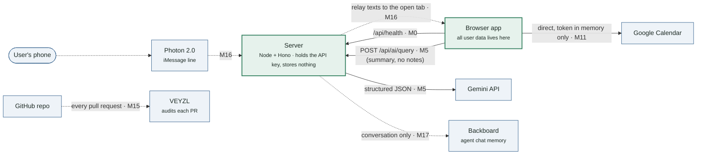
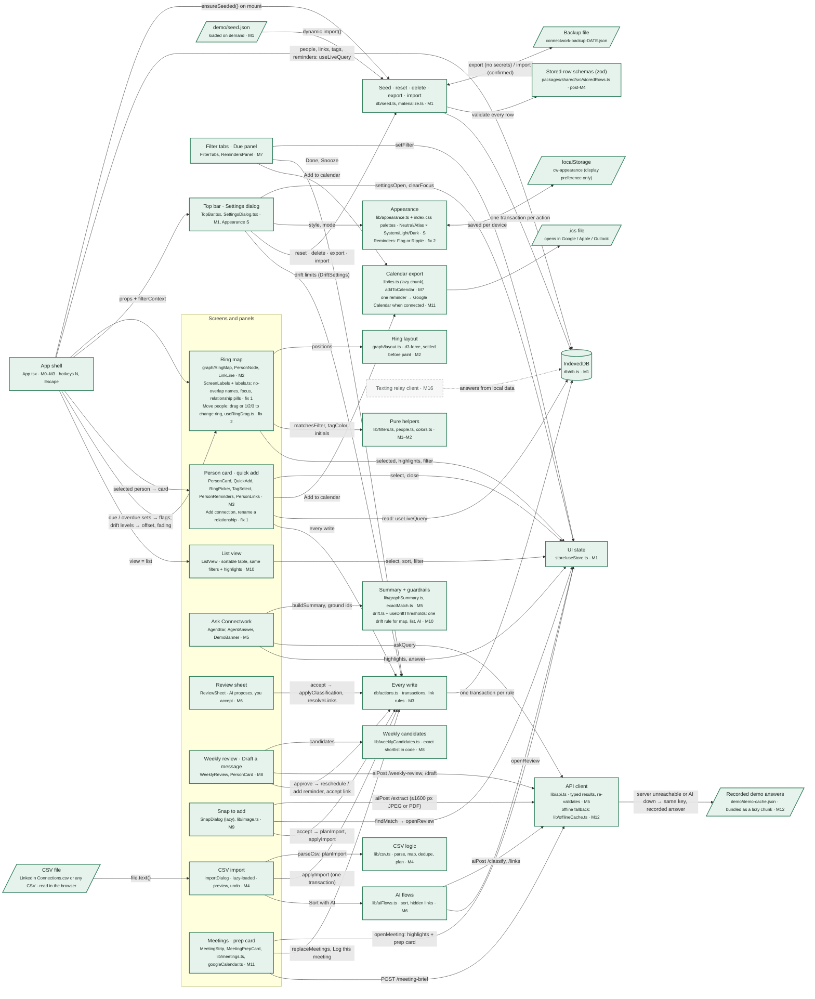
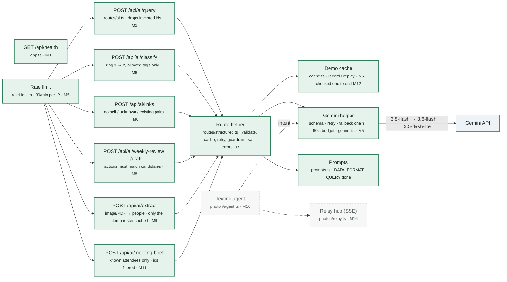

# Connectwork — Architecture (living graph)

**Updated after every milestone.** Green boxes and solid arrows are **built**; dashed gray ones are **planned**; blue boxes are outside services. Each box names its file(s) and the milestone that builds it. GitHub renders these diagrams; in VS Code use a Mermaid preview extension.

**Current state: M12 built**: everything through M11, plus a *demo that survives bad Wi-Fi*. On judging morning the scripted demo's AI answers are recorded ([DEMO_DAY.md](DEMO_DAY.md)); the server replays them, and if the server can't be reached, the browser answers from the same recording. Deploy (M13–M14) and later are scaffolds. Open items: [OPEN_ISSUES.md](OPEN_ISSUES.md).

### 1. The big picture

### 2. Inside the browser

### 3. Inside the server

## Where data lives (privacy at a glance)

| Data | Lives in | Leaves the browser? |
| --- | --- | --- |
| People, links, reminders, notes, settings | IndexedDB in the user's browser (and backup files the user exports, unencrypted) | Only as an opt-in AI request: a compact summary without notes (M5); notes only for a person the user asks about (M8 draft, M11 brief) |
| Gemini API key | Server `.env` | Never reaches the browser |
| Google Calendar token | Browser memory only | Sent only to Google |
| Texts to the agent | Photon → server (in memory) → browser tab | Optional: the conversation (never the network) to Backboard |
| Demo reply cache | `demo/demo-cache.json` | Contains demo data only |

## Milestone status

| Milestone | Parts | Status |
| --- | --- | --- |
| M0 | App shell ↔ `/api/health` | ✅ built |
| M1 | IndexedDB, seeding, UI state, settings | ✅ built ([review](REVIEWS.md#m1)) |
| M2 | Ring map | ✅ built ([review](REVIEWS.md#m2)) |
| M3 | Every write (`actions.ts`), person card, quick add | ✅ built ([review](REVIEWS.md#m3)) |
| M4 | CSV import | ✅ built ([review](REVIEWS.md#m4)) |
| M5 | Ask Connectwork → `/api/ai/query` → Gemini | ✅ built ([review](REVIEWS.md#m5)) |
| R, M6 | Route helper; review sheet; classify + links | ✅ built ([review](REVIEWS.md#m6)) |
| S | Style switching (intermediary step, requested Oct 17) | ✅ built ([review](REVIEWS.md#step-s-style-switching)) |
| M7 | Flags, filter tabs, Due panel, .ics | ✅ built ([review](REVIEWS.md#m7)) |
| M8 | Weekly review, Draft a message | ✅ built ([review](REVIEWS.md#m8)) |
| M9 | Snap to add (photo / PDF → people) | ✅ built ([review](REVIEWS.md#m9)) |
| Fix 1 | Map labels (no overlap, zoom-proof), click focus, named connections, Add connection | ✅ built ([review](REVIEWS.md#fix-step-1-map-labels)) |
| Fix 2 | Ripple reminder style, "Move people" edit mode (drag or keys to change ring) | ✅ built ([review](REVIEWS.md#fix-step-2-map-features)) |
| M10 | Drift on the map, drift limits in Settings, list view, keyboard path | ✅ built ([review](REVIEWS.md#m10)) |
| M11 | Google Calendar (browser only), sample meetings, meeting strip, prep card, Log this meeting | ✅ built ([review](REVIEWS.md#m11)) |
| M12 | Demo hardening: record / replay checked, browser offline fallback, DEMO_DAY runbook | ✅ built ([review](REVIEWS.md#m12)) |
| M13–M14 | Deploy | ⬜ |
| M15–M17 | VEYZL, Photon texting agent, Backboard | ⬜ |

## Changelog

| Date | Milestone | What changed in the graph |
| --- | --- | --- |
| Oct 17 | — | First version, as three diagrams (big picture, browser, server): M0 built (App ↔ health); everything else planned. |
| Oct 17 | M1 | Browser diagram: demo file, App, top bar + Settings, UI state, seed module and IndexedDB are built; added the backup file and the real arrows (seed on mount, live count, Settings → seed → one transaction per action). Status: M1 ✅, M2 next. |
| Oct 17 | M2 | Browser diagram: ring map built, with its layout (d3-force) and pure helpers as new boxes; App now feeds the map from four live queries; the map reads selection, highlights and filter from the store. Planned UI arrows now start from the person card (M3). Status: M2 ✅, M3 next. |
| Oct 17 | M3 | Browser diagram: `actions.ts` and the person card / quick add are built; App opens the card for the selected person; the card reads live and writes only through `actions.ts`, which writes to IndexedDB in transactions. Planned: CSV import will write through `applyImport`. Status: M3 ✅, M4 next. |
| Oct 17 | M4 | Browser diagram: CSV file, CSV logic (`lib/csv.ts`) and the import dialog are built; the file is read in the browser, planned (dedupe, fill-only) and written through `applyImport` in one transaction. Status: M4 ✅, M5 next. |
| Oct 17 | post-M4 | Open-issues step: added the stored-row schemas that every backup row is checked against; backups carry no secrets and ask before replacing; the import dialog is lazy-loaded and has Undo. |
| Oct 17 | M5 | Big picture: browser → server → Gemini is built. Browser: Ask Connectwork, summary + guardrails, API client. Server: rate limit, `/api/ai/query`, demo cache, Gemini helper (fallback chain, 60 s budget) and prompts are built. Status: M5 ✅, R/M6 next. |
| Oct 17 | R + M6 | Server: every AI route goes through the route helper; classify and links are built. Browser: AI flows (sort, hidden links) and the review sheet are built; accepting writes through `actions.ts`. Status: R/M6 ✅, style switching next. |
| Oct 17 | S | Browser: Appearance (style + mode) built; Settings sets it, `localStorage` remembers it per device, and the map's colours come from `--map-*` variables. Status: S ✅, M7 next. |
| Oct 17 | M7 | Browser: filter tabs + Due panel and calendar export (with the .ics file as an output) are built; App feeds due/overdue/drifting sets to the map for flags. Status: M7 ✅, M8 next. |
| Oct 17 | M8 | Browser: weekly review panel + candidates (code) built; approving writes through `actions.ts`. Server: `/weekly-review` and `/draft` on the route helper. Status: M8 ✅, M9 next. |
| Oct 17 | M9 | Browser: Snap dialog (lazy, shares the CSV chunk) + image prep built. Server: `/extract` on the route helper, roster-only caching. Status: M9 ✅, M10 next. |
| Oct 17 | Fix 1 | Browser: the ring map gains a screen-space label layer (`ScreenLabels.tsx` + pure `labels.ts`); the person card can add and rename connections through `actions.ts` (`upsertLink`, new `renameLink`). No new arrows: same store, same database. Status: fix 1 ✅, fix 2 (ripple pulse, drag-to-ring) next. |
| Oct 17 | Fix 2 | Browser: Appearance gains Reminders (Flag/Ripple, an `<html>` attribute + CSS); the ring map gains "Move people" (`useRingDrag.ts`, an `editRings` flag in the UI state), which writes ring changes through `actions.ts` (`updatePerson`). No new arrows. Status: fix 2 ✅, M10 next. |
| Oct 17 | M10 | Browser: new List view box (App → List → UI state); App computes each person's drift once and feeds the map (offset, fading) and list; Settings writes the drift limits through `actions.ts`; Summary + guardrails now names the single drift rule (`drift.ts`, `useDriftThresholds`). Server: `/query` takes optional limits. Status: M10 ✅, M11 next. |
| Oct 17 | M11 | Big picture: browser ↔ Google Calendar is built (direct, token in memory). Browser: new Meetings box (strip + prep card) that opens meetings through the UI state, writes through `actions.ts` and calls `/meeting-brief`; calendar export sends one reminder to Google when connected. Server: `/meeting-brief` replaces the planned "more routes" box. Status: M11 ✅, M12 next. |
| Oct 17 | M12 | Browser: the API client gains an offline fallback to the recorded demo answers (`demo/demo-cache.json`, a lazy chunk), keyed exactly like the server's cache (`cacheKeyAsync` in shared). Server: demo cache unchanged, checked end to end. Status: M12 ✅, M13 next. |
