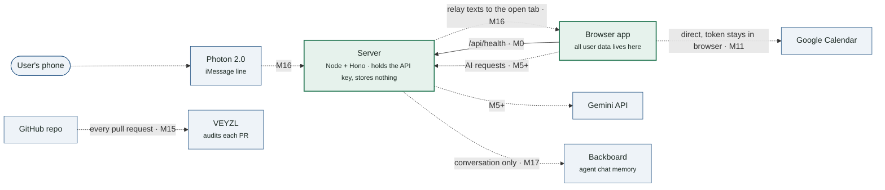
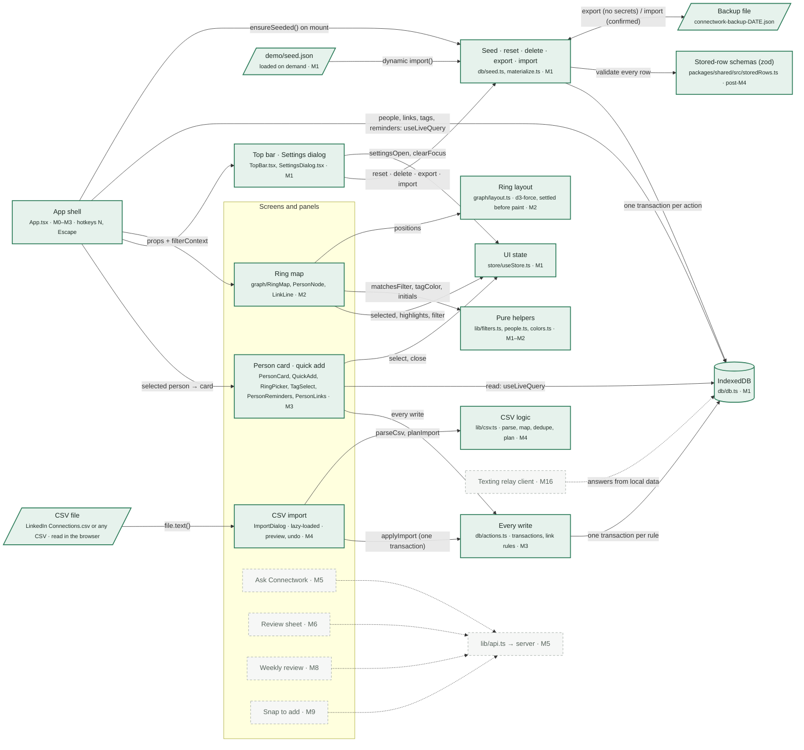
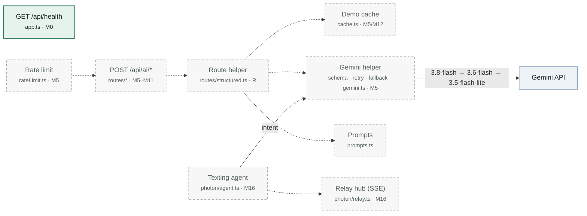

# Connectwork — Architecture (living graph)

**Updated after every milestone.** Green boxes and solid arrows are **built**; dashed gray ones are **planned**; blue boxes are outside services. Each box names its file(s) and the milestone that builds it. GitHub renders these diagrams; in VS Code use a Mermaid preview extension.

**Current state: M4 built** — the demo network is seeded into IndexedDB and drawn as the ring map; clicking a person opens an editable card; N opens Quick add; Import reads a LinkedIn export or any CSV in the browser, previews it, dedupes and writes it in one transaction; every write goes through `db/actions.ts`. Ask Connectwork (M5) and everything after it are scaffolds. Open items: [OPEN_ISSUES.md](OPEN_ISSUES.md). Self-reviews: [REVIEWS.md](REVIEWS.md).

### 1. The big picture

### 2. Inside the browser

### 3. Inside the server

## Where data lives (privacy at a glance)

| Data | Lives in | Leaves the browser? |
| --- | --- | --- |
| People, links, reminders, notes, settings | IndexedDB in the user's browser (and backup files the user exports, unencrypted) | Only as an opt-in AI request: a compact summary without notes (M5); notes only for a person the user asks about (M8 draft, M11 brief) |
| Gemini API key | Server `.env` | Never reaches the browser |
| Google Calendar token | Browser memory only | Sent only to Google |
| Texts to the agent | Photon → server (in memory) → browser tab | Optional: the conversation (never the network) to Backboard |
| Demo reply cache | `demo/demo-cache.json` | Contains demo data only |

## Milestone status

| Milestone | Parts | Status |
| --- | --- | --- |
| M0 | App shell ↔ `/api/health` | ✅ built |
| M1 | IndexedDB, seeding, UI state, settings | ✅ built ([review](REVIEWS.md#m1)) |
| M2 | Ring map | ✅ built ([review](REVIEWS.md#m2)) |
| M3 | Every write (`actions.ts`), person card, quick add | ✅ built ([review](REVIEWS.md#m3)) |
| M4 | CSV import | ✅ built ([review](REVIEWS.md#m4)) |
| M5 | Ask Connectwork → `/api/ai/query` → Gemini | ⬜ next |
| R, M6 | Route helper; review sheet; classify + links | ⬜ |
| M7–M14 | Flags/filters, weekly review, snap, drift, calendar, demo cache, deploy | ⬜ |
| M15–M17 | VEYZL, Photon texting agent, Backboard | ⬜ |

## Changelog

| Date | Milestone | What changed in the graph |
| --- | --- | --- |
| Oct 17 | — | First version, as three diagrams (big picture, browser, server): M0 built (App ↔ health); everything else planned. |
| Oct 17 | M1 | Browser diagram: demo file, App, top bar + Settings, UI state, seed module and IndexedDB are built; added the backup file and the real arrows (seed on mount, live count, Settings → seed → one transaction per action). Status: M1 ✅, M2 next. |
| Oct 17 | M2 | Browser diagram: ring map built, with its layout (d3-force) and pure helpers as new boxes; App now feeds the map from four live queries; the map reads selection, highlights and filter from the store. Planned UI arrows now start from the person card (M3). Status: M2 ✅, M3 next. |
| Oct 17 | M3 | Browser diagram: `actions.ts` and the person card / quick add are built; App opens the card for the selected person; the card reads live and writes only through `actions.ts`, which writes to IndexedDB in transactions. Planned: CSV import will write through `applyImport`. Status: M3 ✅, M4 next. |
| Oct 17 | M4 | Browser diagram: CSV file, CSV logic (`lib/csv.ts`) and the import dialog are built; the file is read in the browser, planned (dedupe, fill-only) and written through `applyImport` in one transaction. Status: M4 ✅, M5 next. |
| Oct 17 | post-M4 | Open-issues step: added the stored-row schemas that every backup row is checked against; backups carry no secrets and ask before replacing; the import dialog is lazy-loaded and has Undo. |
